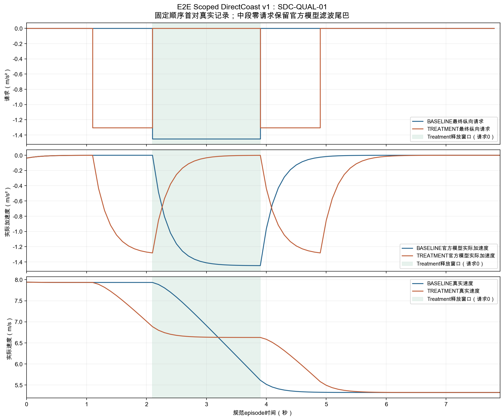

# E2E Scoped DirectCoast v1 — 中文总报告

日期：2026-10-25（Asia/Shanghai）。项目forwardxp-021/E2E-Evaluation，分支20260825_stageR_new。起点提交53afb800e5ad14771d31e1e7a3e6a01134ab5721。

## 1. 最终结论：在明确适用域内做成了

**`E2E_SDC_V1_QUALIFICATION_PASS_20_OF_20`**。

新版本独立命名为**E2E Scoped DirectCoast v1（SDC-v1）**。3对开发实验全部通过；随后在未用于本版开发的20个不同SESSION中，固定名单、固定控制、固定阈值各执行两臂一次，**20/20对通过**。正式资格共40个首次arm，科学失败0、技术失败0、重试0、未运行0；没有根据资格结果修改名单、参数或规则。

通过范围是：**离线预先检查过交通占用、道路走廊和初始条件的低曲率路段**。不是全部交通SESSION的通用安全成功，不是RBR/H30检测优势，也不是20/20等于总体通过概率100%。旧P2-Q1的科学FAIL永久保持。

## 2. 最终方法：保留F2控制，用物理适用域解决问题

选择方案A，**没有研发新的避障算法，没有修改纵向适配器、横向LQR或官方车辆模型**。原F2已经证明直接请求可以产生所需行为，本版只把它应用于事前可解释的场景域，并建立独立调度和完整分母验证。

### 控制与测量逐值继承F2

- Baseline：[2.1,3.9)秒请求−1.45m/s²，其余0。
- Treatment：[1.1,2.1)及[3.9,4.9)秒请求−1.305m/s²，中间[2.1,3.9)秒及其余时间0。
- 两臂均为同一个ScriptedLongitudinalRequestTrackerV1、横向LQR、官方KinematicBicycleModel（加速度滤波tau=0.2秒）、原native-route planner和同一观察链。纵向LQR/停车控制不介入，不直接赋值车辆状态，不使用正向补偿。
- 规范10Hz、80状态/79推进及各SESSION原始same-index映射不变。机制使用median3真实速度和物理时间gradient，在原[1.1,5.5]秒有效域内判断一次/两次制动。初始动力学状态可能有滤波尾，未裁剪实际记录或把其当作新增主动请求。
- 原峰值≥0.8m/s²、支持≥0.4秒、门槛内剂量≥0.35m/s、双段分离≥0.7秒保持。四F容差仍为0.10m/s、0.15m/s、0.80m、0.02m/s²；六位规则及epsilon不变。额外全窗负剂量差≤0.15m/s、每脚T相对B峰值差≤0.20m/s²保持。
- 官方责任碰撞=0、drivable-area=true保持，未放宽任何官方阈值。

### 适用性：在原始数据与地图上检查，不试跑筛样本

1. 数据角色、身份及来源完整，排除E3/E4、未知来源和全部Primary C低暴露资源。基础框为既有248 SESSION普查；保留S2静态适格及原代表初速≥5m/s的元数据预选，每SESSION仍只使用原已确定的代表LOG。
2. 每LOG事前按固定SHA256排序取最多16个有状态支持的tagged anchor，选择其中第一个静态适格时刻。不根据rollout、碰撞、机制或F_match结果寻找时刻。
3. 候选初速≥5m/s，初始朝向相对native中心线误差≤0.10rad、横向偏移≤0.40m；整个检查路段切线角范围≤0.15rad。这是低曲率适用域，不是全道路能力。
4. 按原模型零/负请求构造保守速度界：v_max=v0+0.2max(a0,0)，v_min=max(0,v0−2.61−0.2|a0|)。此处仅为解析运动学界，不调用车辆模型推进，也不判断资格PASS/FAIL。
5. native路线走廊宽度为车体半宽+1.0m，前后另留车体长度及1.0m纵向余量；原DRIVABLE_AREA多边形必须覆盖完整走廊，走廊必须覆盖实际初始车体。没有扩张地图、缩小车辆或调整安全阈值。
6. 在每个0.1秒时刻，用上述速度界形成纵向可达区间，再检查原始同index及相邻帧对象包围盒的凸包是否占用该时刻走廊。存在占用冲突就排除。这是保守的源数据占用检查，不是新仿真碰撞结果。

**第6项使用未来8秒左右的离线原始交通信息。** 它定义受控离线实验适用性，不能宣称在线部署或未知未来交通下的避障能力。对象与地图近边界误差、采样间运动等限制仍存在。

## 3. 覆盖率与排除：通过的是有限场景域

| 冻结框中的项目 | SESSION数 |
|---|---:|
| 原静态普查总框 | 248 |
| 资格池政策/来源/预选排除 | 110 |
| 实际按最终规则检查的独立资格候选SESSION | 138 |
| 在固定16-anchor框中适格 | 37 |
| 物理/来源检查后无适格anchor | 101 |
| 固定哈希顺序抽取并执行 | 20 |

最终适格覆盖率为37/138=**26.81%**；相对原248框为37/248=**14.92%**。只代表这个既定LOG及最多16-anchor抽样框，不声称扫描了各SESSION全部时间或整个nuPlan数据集。

110项政策/预选排除按首要原因互斥统计：资格池之外49、E3/E4共31、原代表初速不足5m/s共23、Primary C/E5共5、原静态不适格2。20个开发池SESSION在资格池之外，无论是否实际运行都不进入资格名单；旧B1、旧P2全部20名单及原DEV也排除。

最终资格普查累计检查1864个anchor。候选anchor的排除原因可以重叠，主要为：道路走廊不被原DA完整覆盖703次、候选初速不足688次、官方唯一可运行身份不满足418次、曲率域391次、初始横向偏移341次、native初始edge不可用197次、初始朝向68次、逐时刻交通走廊冲突65次；完整原因见Anchor_Exclusions_v1.csv。不能把这些静态排除等同于已经运行并失败的科学实验。

最终20个SESSION覆盖Pittsburgh 18个、Las Vegas 2个；初速度范围6.288948～14.249621m/s。它们相对本版开发池、旧B1、旧P2和原DEV的SESSION重叠为0，原始LOG token和完整DB文件hash也均为20个不同身份。此前暴露等级为16个E1、4个E2，不能声称从未历史使用或Claim-A未见SESSION泛化。

## 4. 开发与首次资格执行前的修正，全部保留

开发使用独立池，最多60个attempt授权，实际只使用3对、6个attempt，科学失败0。所有源码和实际执行来源有阶段绑定，没有删除尝试。

在开发静态检查中，修正了走廊平头端点缺少车体倾斜纵向余量的问题；把不考虑时间的整窗对象凸包检查改为逐时刻保守可达区间，避免把完全不同时间的道路占用误判为冲突；将任意一个历史代表时刻扩展为事前固定16-anchor框。原v1～v4设计和检查结果全部保留。以上均在资格来源检查前确定，未使用资格rollout或检测结果。

开发生产零运行预检修正了一个报告比较问题：正式工厂比静态时钟报告多observer/shared_original_scenario两项注记，81个真实时间/token映射本来相同。原错误和未绑定入口的拒绝日志均保留，未产生科学attempt。

另一个遗漏在资格零运行预检发现：16-anchor生成器未把原官方get_scenarios_from_db的唯一可运行身份前置条件应用到每个新anchor，导致部分日志边缘时刻无法装配。**当时资格科学attempt为0**。修复恢复了原官方谓词，没有修改官方查询、物理阈值、固定16候选框或哈希salt。初稿47适格SESSION和未运行v1名单保持只读，明确标为预检阻断；重新审查完整同一框后得到最终37适格SESSION，最终v2名单比未执行初稿有3个SESSION差异，差异文件公开保留。

该修复没有利用任何资格机制、F_match或安全结果，不是科学失败后的换样本。**最终v2完整20名单在首次资格科学运行前提交冻结（244f3de）；随后40/40零运行装配通过，正式绑定c41fa2f提交后才领取首个资格attempt。** 从第一个真实资格attempt开始，名单、规则、科学源码和参数未再改变。

## 5. 真实独立资格结果

| 资格项目 | 结果 |
|---|---:|
| 完整执行的独立SESSION pair | 20/20 |
| 技术、机制、官方安全通过arm | 40/40 |
| Baseline恰好一段合格制动 | 20/20 |
| Treatment恰好两段合格制动 | 20/20 |
| Treatment释放窗口精确零请求 | 每臂18/18，共360次 |
| 正式四F、额外剂量与峰值平衡 | 20/20 |
| 新增时序差异资格 | 20/20 |
| 科学失败、技术失败、重试、未运行 | 均0 |

Baseline合格支持段均约1.8秒，峰值1.448773408～1.448773637m/s²，门槛内剂量2.352323102～2.352366035m/s。Treatment共40脚，支持均约0.9秒，峰值1.276441566～1.276779578m/s²，剂量1.004936255～1.006342511m/s。最低实际速度3.843855084m/s，没有低速端停或reference floor失败。

| 四F绝对差（冻结六位结果） | 20对最大值 | 原容差 |
|---|---:|---:|
| mean_speed（m/s） | 0.000001 | 0.10 |
| end_minus_start_speed（m/s） | 0.000002 | 0.15 |
| path_length（m） | 0.000001 | 0.80 |
| mean_abs_accel（m/s²） | 0.000765 | 0.02 |

全窗负剂量差最大0.003674147m/s（限0.15）；每脚T相对B峰值差最大0.172331842m/s²（限0.20）。原始全精度状态、未舍入描述符和冻结结果分开保存，未换算子重新挑选有利结果。

40个资格arm的原始官方parquet逐项交叉核对，责任碰撞计数均0、drivable-area均true；原serializer、callbacks、metric finalizer、simulation log和actual-observation审计全部完整。各自的raw观察与规范时钟偏差范围−1363～+1189µs，没有套用其他SESSION时间表。

## 6. 两臂确实不同，没有误用同一轨迹

在Development阶段事前确定新增资格：最大实际速度差≥0.5m/s，实际轨迹hash不同、最终请求数组不同，且两臂相同前置状态和物理时刻必须匹配。20对中最小的最大实际速度差为**1.085684093m/s**，全部轨迹和请求数组不同；两臂最终降速及整窗摘要仍充分匹配。它们相似的是低阶整窗量，差异是预定的制动时序。

代表图事前规定取冻结顺序首对SDC-QUAL-01，不按检测效果或成功程度挑图。上图是实际最终请求，中图是原官方模型实际加速度，下图是真实current-ego速度；阴影为Treatment释放窗口。零请求后仍有模型滤波减速尾巴，没有把参考曲线冒充实际曲线。

## 7. 成本、代码与可复现证据

- Development 6个首次arm，科学子进程及可计量后代CPU51.716537秒；Qualification 40个首次arm，CPU400.054126秒；合计**451.770663秒**。调度进程CPU不伪报为已精确测量；另按两个科学驱动执行日志的原始创建至最终写入墙钟包络×本机10逻辑核，得到含父/子进程全部科学执行CPU的保守上界**5584.595070秒**，仍小于10800秒。metadata-only准备不计科学执行，未调用模型传播。最大单arm墙钟13.559260秒，低于1200秒。
- 新代码：sdc_v1_selection.py负责角色隔离、固定anchor顺序及静态走廊；sdc_v1_prepare.py负责名单和非循环绑定；sdc_v1_execution.py负责独立进程、共享预算、完整分母和时序差异门；sdc_v1_results.py与sdc_v1_audit.py负责只读汇总和完整性审计。原F2 tracker/planner/model/recorder/analyzer源码未改，未新增避障或训练模块。
- 原S1/S1R、Primary、旧B1/C2/F2/P2账本和用户已有文件保持。6017项历史保护文件、1075项原F2源码/配置复核一致。原受保护CSV SHA256仍为e8deb93312e82183b6c2c0db30fd18cbf9c32d32d566038419a5be65b389d9d8。
- 7项权限、重复领取、科学失败继续、技术失败阻断、CPU预算、时序同轨迹拒绝、官方身份测试通过；编译和check_no_tmp_dependencies通过。对46个实际arm、1587项原始产物、46个前后版本manifest逐项复核；停止后全部40个资格run ID领取均拒绝，账本不变。
- 当前独立总账本stopped=true，共46attempt，不能删除/重置后复跑。所有实际访问的158个B来源SESSION按适用性检查和实际执行分别追加E2事件；没有把E1/E2重标E5，没有打开Primary C保护源或E3/E4数据。

可直接审查的文件：

- QUALIFICATION_Frozen_Roster_v2.json及Frozen_Qualification_Protocol_v1.json：最终20名单与冻结物理/科学合同；Qualification_PreExecution_Metadata_Closure_v1.json说明唯一可运行身份的前置修复。
- Pair_Results_v1.csv、Arm_Mechanism_Safety_v1.csv、FMatch_v1.csv：3开发+20资格完整分母、机制、匹配、安全和失败分布。
- All_Actual_States_And_Requests_v1.csv、Unrounded_Descriptors_v1.csv、Representative_Actual_Curves_v1.csv：全部3680个真实状态、3634次推进和代表图原始数值。
- Applicability_Coverage_v1.csv、Anchor_Exclusions_v1.csv、Exposure_Ledger_v1.csv：覆盖率、逐项排除及暴露记录。
- Execution_Ledger_v1.json、Manifest_v1.json及evidence：尝试、资源、源码/配置/数据/产物SHA256和验证。
- 完整本轮原始科学目录outputs/stageR/e2e_sdc_v1，以及预算文件outputs/stageR/e2e_sdc_v1_state/budget.json；本轮完整科学产物与必要零运行配置随Git保存，历史目录未改。

正式科学复跑仍需要新的授权和独立输出/账本，不能借“复现”删除已冻结记录。本地数据和地图受实际来源hash及冻结路径约束；本交付支持查看原始记录和审计重现，不声称任意机器无需数据即可运行。

## 8. 科学价值与仍未解决的问题

可以支持：在有限、明确、前瞻性场景域中，通过同一动力学和公平接口产生可复现的一次/两次制动时序干预，低阶整窗量匹配、官方安全合格，并为将来RBR64与强H30的受控比较提供B基准。

不能支持：通用端到端策略优越性、未知行为发现能力、真实零轮端扭矩滑行、在线动态交通安全、连续时间碰撞免疫或全交通泛化。“E2E”指闭环轨迹与官方评估链；本版没有学习式驾驶策略，也没有一般避障规划器。

原官方模型只有净加速度请求，保留ABSTRACT_COAST_PROXY_ONLY。离线未来交通筛选和DISCLOSED_OFFLINE_SAME_INDEX_REPLAY_NOT_STRICT_EVENT_TIME_CAUSALITY必须同时披露。SESSION是批准的独立统计单位，不是独立driver/车辆/城市证明。

四F匹配不等于完整人工特征或所有低阶混杂消除；**LOW_ORDER_NUISANCE_ELIMINATED=NOT_ESTABLISHED，TSB_CLEAN_RESIDUAL_TASK=NOT_ESTABLISHED**仍保持。H30可以捕捉时序，不得因它可能较强而削弱它。当前20/20不是Primary功效证明，也不自动把这20个B样本变成V/C或批准的Primary干预。

未来RBR/H30比较仍须遵守U-only架构/loss/checkpoint/seed选择、强H30、相同样本/报警预算、原统计协议及PRIMARY_FREEZE_POINT；不能用本次资格结果选择encoder或筛选有利V/C。本轮RBR训练、推理、H30比较、MMD/BDD Primary及V/C均0。

**本任务已完成并停止。** 工程上没有待继续调试的阻断；仍存在的科学局限是场景覆盖有限、离线未来信息和简化动力学/非反应式回放。它们已明确界定，而不是通过扩大工程范围掩盖。新资格成功不改变旧B1历史20/20、C2 FAIL、F2 Development PASS及P2-Q1 FAIL。
