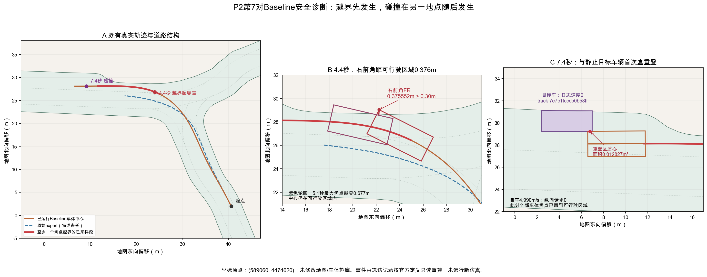

# P2-Safety Review — 第7对Baseline安全失效只读归因 v1

日期：2026-10-25（Asia/Shanghai）。基准提交：9f00c5b61b2a578f58fae1dff1f36e2443887656。对象仅为DIRECTCOAST-P2-07-BASELINE / SESSION 2021.09.27.17.52.47_veh-44 / scenario da7a9065299e5cc2。

## 先回答两个问题

**首次采样碰撞在episode 7.4秒、0-based第74帧（第75个状态）：自车以4.990431m/s、纵向请求0，与track `7e7c1fcccb0b58ff`的停驶车辆发生车体包围盒重叠。官方类型为STOPPED_TRACK_COLLISION。** 该时刻自车车体中心为(589069.180764, 4474648.107263)，重叠区质心为(589066.789340, 4474649.226755)。后者是诊断几何位置，不是真实物理接触点。

**可行驶区域失效先发生：4.2秒右前角首次越界0.114257m；4.4秒越界0.375552m，超过原官方0.30m容差。** 4.4秒车体中心为(589084.038170, 4474646.846162)，右前角为(589082.246553, 4474649.038627)。中心全80帧仍在可行驶区域，失败来自车体角点，不是中心驶出。

两者不是同一时间、同一位置的事件：碰撞比首次超过容差晚3.0秒，两个事件的车体中心相距14.910831m；全部角点已在6.9秒恢复合规，碰撞发生时没有同时角点越界。它们位于同一转弯后路段的不同位置，但本证据不能证明前一次越界导致后一次碰撞。

图中坐标为官方map API按GPKG meta的projectedCoordSystem=epsg:32617转换后的米制坐标，绘图只减去原点(589060,4474620)。GPKG原始geometry注册为EPSG:4326，不能将其原始经纬度直接与轨迹米坐标比较；本审查完全复用官方投影后的地图，没有改地图、轮廓、容差或投影。图中绿色为原始可行驶区域，虚线为原始expert中心轨迹，红色为角点越界时段对应的自车中心轨迹。

## 1. 证据等级和方法

### 官方产物直接报告的内容

- no_ego_at_fault_collisions.parquet：责任碰撞总数1，与vehicles碰撞1、VRU和objects均0，delta-v能量代理2.4952157028797544m/s。time_series_timestamps/values均为空，没有事件时刻、对象ID、碰撞类型或接触位置。
- drivable_area_compliance.parquet：全程不合规0.0，没有事件时间序列。
- corners_in_drivable_area.parquet：80个规范时刻与角点合规0/1；索引42～68共27帧为0，索引69起恢复1。这是“至少一个角点越界”的直接逐帧证据，不能把4.2秒自动当成超过0.30m容差的时刻。

### 只读重建的内容

读取已有simulation log中的80个ego状态、80组同index对象与已存规划轨迹，调用冻结官方find_new_collisions、route-extractor和逐角点几何helper定位事件；没有调用metric engine.compute、runner、planner或车辆传播。碰撞ID、7.4秒、STOPPED_TRACK_COLLISION、重叠位置、4.4秒及边界距离均属于该层，不伪称来自parquet。

重建得到的责任碰撞数、delta-v代理、80点corners序列和全程drivable结果与既有产物一致；这是诊断一致性检查，未生成或替换正式资格结果。全部13个已执行arm使用相同接口检查。expert只使用原始日志状态作描述，不构建或运行无干预反事实。

## 2. 碰撞：对象、时刻、位置与责任定义

| 项目 | 定位结果 |
|---|---|
| 首次采样重叠 | 7.4s；index74；simulation time_us=1632766462349783 |
| 前一采样 | 7.3s、index73；两盒最小间距0.099224737m，无重叠 |
| 原始观察时刻 | 1632766462349952µs，比规范时刻晚169µs；原同index对象未换帧 |
| 对象 | VEHICLE；track_token=7e7c1fcccb0b58ff；此帧object_token=af8516ada11a5163 |
| 对象状态 | 官方速度字段0m/s，中心(589064.711013,4474650.157195)，heading约−0.002994rad |
| 自车状态 | 中心(589069.180764,4474648.107263)，rear axle(589070.641743,4474648.115153)，speed=4.990431406m/s |
| 控制与模型 | 当帧发出的纵向请求0；模型当前加速度−0.000000995m/s²；不在Baseline[2.1,3.9)s制动窗口 |
| 几何位置 | ego右前区域与对象盒重叠；质心(589066.789340,4474649.226755)，面积0.012826554m² |
| 后续记录 | index74～79持续重叠；末帧面积0.157699610m²；同一个track仅计一次 |

官方_get_collision_type先判断ego停止，再判断目标停止；目标速度≤0.05m/s即STOPPED_TRACK_COLLISION，因此本事件不能改称ACTIVE_FRONT_COLLISION，也不能凭名称称为追尾。两车heading接近相反，车体右前区域擦入目标盒，但不能仅凭日志判断对方是合法停车、排队还是其他真实驾驶状态，均为UNKNOWN。

classify_at_fault_collisions将STOPPED_TRACK_COLLISION直接计入责任碰撞，不要求该时刻ego在可行驶区域外。此帧common_or_connected_route=false也不是本次责任成立的必要条件。这里“责任”是nuPlan的简化可避免碰撞规则，不是交通法规归责。原delta-v代理按两车速度/朝向及默认等质量公式计算，不是仿真车辆真的发生碰撞冲击后减速。

确切连续接触时间与真实接触点为UNKNOWN：能确定的是最后非重叠采样7.3s和首次重叠采样7.4s，不对中间运动作仿真或插值断言。目标80帧速度字段均0，但中心位置在日志中约有0.261m的x范围及0.550m的y范围；速度字段为0不代表包围盒坐标完全不变。首次薄重叠及感知盒/时间离散限制保留，后续5帧仍有重叠，未因此改判PASS。

## 3. 可行驶区域：哪个角点、什么边界

官方使用原Pacifica车体轮廓：长5.176m、宽2.297m，rear-axle至中心1.461m；四角顺序FL/RL/RR/FR。不是检查rear axle或车体中心是否在路内。

具体定义：角点没有lane/lane-connector归属且不在DRIVABLE_AREA时，属于outside。若角点距当前中心所属lane/connector小于0.30m，允许该边界例外；否则查询最近DRIVABLE_AREA，多边形距离≥0.30m或距离缺失即far violation。任一帧出现far后，全程compliance保持失败，后来回到路内也不清除。

| 时刻 / index | 几何事实 |
|---|---|
| 4.1s / 41 | 所有角点尚合规 |
| 4.2s / 42 | FR=(589083.343192,4474648.754209)，距最近DA对象17583为0.114257m；首次outside，尚未far |
| 4.4s / 44 | FR=(589082.246553,4474649.038627)，距最近DA对象17583为0.375552m；距中心lane18128为0.429098m，两种距离均不满足0.30m例外，首次far |
| 5.1s / 51 | FR=(589078.385870,4474649.452883)，距DA对象30995为0.677095m，全窗最大角点越界；车体中心仍在路内 |
| 6.8s / 68 | 仍有角点outside（RR距DA约0.070050m），但该帧不是首次超容差 |
| 6.9s / 69 | 所有角点重新合规；全程官方compliance仍为false |
| 7.4s / 74 | 碰撞时所有车体角点在DA内，车体在DA外面积0 |

全窗outside共27帧，逐帧far共22帧（不必连续，不能用22×0.1冒充精确持续时间）。最大车体在DA外面积约1.868470m²；这是新增描述性面积，不是原资格条件。图上的最近点线段直接来自原多边形，无buffer、扩张、简化或车辆缩小。

这证明转弯时车身外廓与道路边界发生空间不兼容，不支持“地图缺失导致无距离返回”：本次最近多边形ID和有限距离均可查，原始expert同一区域80帧未出现outside/far。不过，expert不越界不能证明地图绝对没有标注误差。

## 4. 控制、规划参考与既有对照

### 已证实

1. 初始scene_type=on_stopline_stop_sign；初态角点合规、无对象盒重叠。原初速度7.886355m/s、加速度−1.426583m/s²。不能归类为“初始已经碰撞或越界”。
2. 冻结脚本0～2.1秒请求0，2.1～3.9秒−1.45，其后0。原官方模型保留初始负加速度的短尾，2.1秒速度仍7.600488m/s；原expert同index速度约4.029972m/s。到7.4秒，脚本车仍约4.990m/s，未因前方/侧方停驶对象再次制动。tracker与planner源码均没有利用交通对象生成响应式纵向请求或避障。
3. 横向LQR正常输出，车辆在转弯过程中沿道路北侧过近边界。3.4秒已保存的规划轨迹，其+1秒参考车体FR就在原DA之外；因此不是只有实际车体而参考始终居中合规。native-route builder负责拓扑连接，不保证带offset的整车轮廓安全；_offset_preserving_route_xy保留当前横向/朝向偏移，planner没有车体边界或障碍约束检查。
4. 实际下一状态相对当前已存参考下一点的最大单步横向误差约0.026670m。小单步误差不限制累计偏移，也不能排除LQR/曲率/路线选择的贡献；本轮不能断言某个控制器函数有bug。
5. 原expert在80个同index观察上的车体盒未与任何记录对象重叠，离该目标盒最小约8.323865m；但它推进速度和路径均不同，到7.4秒两ego中心相距11.893696m。它只是日志中的另一条已发生轨迹，不能当作“相同起点无干预运行一定安全”的因果对照。
6. 前6对12arm均无重建碰撞、无角点outside/far，与已有安全PASS一致。最小正角点边界余量约0.204548m（P2-03两arm，0.4秒RL）；最小对象盒间距约0.926065m。存在靠近边界但未越界的情况，不存在本接口漏记它们的同类越界证据；这12arm不是新独立验证集，不能用其成功反推筛选规则。

### 仍不能确定

“减速过晚”是否是唯一或主要原因、提前制动是否避免碰撞、不同横向轨迹是否足够、哪个native lane选择或曲率环节贡献最大，都为UNKNOWN。本轮未执行任何替代控制、Treatment、无干预、时间重对齐或地图变体。

时间语义方面，各帧使用自己的原same-index映射；目标arm偏差范围−682～+314µs，碰撞帧+169µs，首次far帧−93µs。重建与原指标完全一致，没有证据表明结果来自指标实现或时钟接线错误；保留DISCLOSED_OFFLINE_SAME_INDEX_REPLAY_NOT_STRICT_EVENT_TIME_CAUSALITY及包围盒/地图近边界敏感性，不推导现实物理安全结论。

## 5. 分类与科研路线

总分类：**MULTIFACTOR_OR_UNDETERMINED**，其含义是已定位不同的失效机制，但未分离各环节的因果贡献。

| 分类 | 证据结论 |
|---|---|
| TRAFFIC_INTERACTION_LIMITATION | 支持：纵向脚本不响应交通，7.4秒以约4.99m/s与零速度目标盒重叠。不能据此证明只改制动时机即可解决。 |
| LATERAL_ROUTE_OR_DRIVABLE_LIMITATION | 支持：转弯中的车体FR/RR越界，保存的规划参考也有越界；具体route/offset/曲率/LQR责任未分离。 |
| INITIAL_SCENE_OR_LOG_CONDITION | 场景确有stopline、转弯和停驶车；初态并未违规，无证据把失败归咎于损坏或非法初始日志。 |
| METRIC_OR_TIME_SEMANTICS_ISSUE | 需披露离散及回放语义；没有证据支持当前指标或时钟实现错误。 |

F2可以作为**已冻结、可审计的纵向行为分布漂移控制干预**，其命令和模型响应已有真实证据。它目前没有完成原20 SESSION的联合安全资格，不能把干预可实现性等同于动态交通全场景安全。把无交通响应、无车体避障约束的固定脚本无条件用于全部交通SESSION并要求一律安全，缺乏证据支撑；这不授权取消现有安全门或把P2改判PASS。

若未来另立适用域协议，必须独立命名，说明本次失败已暴露；先以物理构念和可观察输入条件制定场景规则及全候选排序，再冻结新样本、分母、预算和停止规则，另获Owner批准。不能用本轮安全、碰撞、F_match或成功6对来调阈值，不能事后删除第7对或将剩余名单当替补；开发曝光按E2登记，独立验证与Claim边界按S1R审查。不能将事后提出的限制宣称为本轮预注册条件，也不应自动将旧B1变成已批准Primary。

**唯一建议：本轮收口，由Scientific Owner审查是否仍有足够论文科学价值支持另立适用域研究；目前没有充分证据直接投入新的Coast科学运行。** 优先推进独立的Waymo U数据、83维合同和RBR训练入口审查时，仍需遵循其各自授权；本轮不启动这些任务。任何新Coast协议、参数、名单、仿真都需后续独立授权。

## 6. 产物、复现与保护

- P2_Safety_Key_Event_Timeline_v1.csv：关键帧、规范/raw时刻、中心/rear位置、当前模型加速度、向下一时段发出的请求、证据等级。
- P2_Safety_Trajectory_And_Events_v1.png / .svg：整段轨迹、越界近景及碰撞近景，只有实际记录与原始expert。
- evidence中的完整诊断、13arm边界余量、官方字段和源码来源索引保留全精度。所有输入、依赖、脚本、产物和测试以Manifest及SHA256绑定。
- tools/p2_safety_readonly_review.py：只读诊断；tools/p2_safety_review_export.py：导出图表和时间表。禁止覆写既有输出，复现应比较本轮记录及hash，不重跑P2。

P2_QUALIFICATION_FAILED永久保持，原账本stopped=true、13attempt不变；第7Treatment及第8～20对未启动。旧B1/C2/F2、原S1/S1R/Primary及用户已有修改均只读保护。仿真、runner、模型传播、科学retry、参数修改、RBR/H30/BDD/MMD、训练及Primary/V/C全部0。完成后停止。

验证结果：6项冻结数据/边界语义/事件去重/时间映射/执行guard/停止账本测试PASS；system与scientific Python编译及check_no_tmp_dependencies PASS。5999项保护文件、1075项F2源码/配置、46项来源及448项原始产物复核一致。提交仅本轮工具、测试、报告、图表、证据和Quick新增节，用户原有未提交改动保留。
