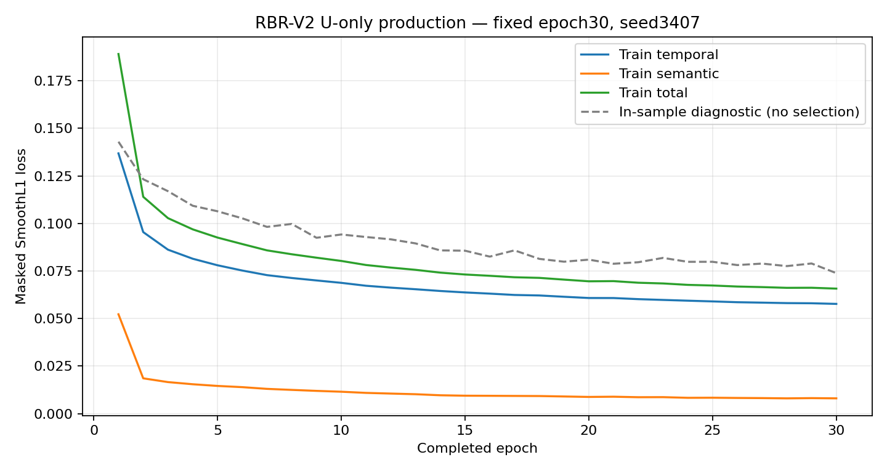

# RBR-V2-PROD：Waymo完整生产与首个正式RBR-64候选

**结果A：`RBR_V2_U_ONLY_TRAINED_CANDIDATE`。附加限制：`U_SOURCE_COMPLETE_INDEPENDENCE_NOT_ESTABLISHED`。**

实际完整语料、随机初始化seed3407、固定30个完整epoch、epoch30唯一交付checkpoint及独立进程z64接口验收均完成。本模型是受限科学主张下的U-only训练候选，不是独立验证成功或检测优势结果。

## 来源、角色与实际分母

本地51份`uncompressed_scenario_training_training.tfrecord-xxxxx-of-01000`属于训练分片命名与Scenario格式一致的子集，**不是全部Waymo训练集**。既有完整文件SHA与每个使用record的payload SHA重新核验。原始下载release收据未在本地找到，不能虚构具体发布版本或上游采集身份链。未发现可认证的独立官方验证来源，因此在第一个正式optimizer step之前冻结`FIXED_EPOCH_30_NO_U_VAL_CHECKPOINT_SELECTION`，不在看到loss后切换路线。

[Waymo官方Motion说明](https://waymo.com/intl/it/open/data/motion/)说明该格式来自重叠的9秒窗口，91个10Hz状态，并且坐标原点可随scene变化；Scenario互斥不能替代原始采集片段互斥。原始segment、跨Scenario对象/绝对时间映射缺失持续披露，旧BLOCKED记录、旧training_certified=false和Smoke模型工程身份均未改写。

既有候选总数168,700；candidate_train原有134,478。
按原观察依赖图隔离一切与candidate/legacy test相连的组后，共118,738个候选；真实物理输入不合格1,895个，保留排除原因，合格率98.4040%。
最终正式训练分母为 **116,843个80×83窗口**，观察依赖组15,829个。窗口数不是完全独立来源数；未按loss、检测或安全结果删样本，也未随机缩小最终训练集合。

全部合格窗口均用于训练。固定256个训练窗口仅作**IN_SAMPLE_NUMERICAL_ONLY**诊断及接口导出，包含在训练分母中；它们不是U_val、泛化测试或新的独立验证集。没有使用U_test、nuPlan B/V/C、SDC、H30或BDD结果选择模型。完整逐行来源、依赖组、raw文件/record偏移与payload SHA、缓存坐标见`actual_training_manifest.csv`。

## Canonical83生产与优化

保留原Canonical83物理公式、槽位选择、mask、80位置10Hz时钟及Semantic13定义，原Stage5/6/7历史数组未作正式输入。按Scenario解码和重采样一次，共享各车辆/时刻的车道投影；批处理只筛选投影候选，最终投影使用原标量内核，阈值边界回到原实现。相同Scenario的多个自车窗口复用这些确定性结果。存储仅作无损布局变化：邻车ID由空字符串/数字字符串映射为-1/int64，不进入网络作为数值特征。

51个源文件分别成为可恢复的认证分片，mmap数组存储x、channel_valid、ego_valid、Semantic13与有效位、slot ID及时间。每个分片独立SHA提交；未完成attempt保留，重启只核验并复用已认证分片，不重复解码全部已完成源文件。不会在每epoch重新解码TFRecord，也不合并全部大数组进内存。

开发固定真实样例与边界测试通过；**每个正式分片的固定窗口**均逐位匹配原处理器，并且重复生产逐位一致。全部51个分片完成。生产墙钟约1286.55秒，实测90.82窗口/秒；6个worker累计7391.63秒（含各worker处理及校验），与墙钟不同。

标准化仅使用全部正式训练窗口的有效字段及目标拟合，角度/presence规则继承原合同，无效TTC/THW不参与拟合。另用独立sum/sum-of-squares重算全语料统计，计数、mean/std均通过。诊断没有额外拟合参数。normalizer SHA：`0e8c9d7daff352ade93232981e2a110cb8daaebe2ac4d283c639b501a95fddc5`。

## 事前冻结与正式训练

预训练冻结提交：`da593b3fa4a0d64f6e1efdebaa3650788d6e2b9d`。该提交包含最终实际样本Manifest、数据/依赖规则、完整模型与训练实现、train-only normalizer、配置及执行冻结；大缓存通过SHA定位而不要求全部入Git。first optimizer step前，执行器强制检查这些冻结文件已提交且源码/hash未改变。

原`GRU128 → shared z64 → Semantic13 + Generic Temporal Head`复用，Canonical83+有效位+物理时间内部167维。seed3407、batch128、AdamW lr0.001、weight_decay0.0001、双loss 1:1、clip1均固定，无scheduler、early stopping、架构或seed搜索。正式模型从随机初始化开始，没有加载Smoke参数。保留随机初始状态及hash便于核验。

遮挡生成优化严格复现原15%两帧span首次访问规则；CPU预取与按shard聚合gather保持样本顺序。真实生产batch的遮挡/标准化逐位匹配原函数；额外梯度审计与单次总loss backward的梯度等价性在更新前通过。正式训练每epoch首批检查两loss对共享encoder的实际梯度，其余正常批次只进行一次总loss backward，不改变真正优化梯度。

实际完成 **30 epoch × 116,843窗口，27,390次有效optimizer.step**。每epoch均保存checkpoint、optimizer/RNG/数据顺序与资源状态；固定选择epoch30，诊断最小值从未选择模型。首epoch训练总loss=0.18908635，末epoch=0.06573015；这些是数值学习记录，不是科学检测效用结论。

唯一正式训练身份，实际执行attempt=1。累计训练设备计费墙钟 **3140.46秒 / 86400秒**；实际epoch训练阶段累计3128.35秒，约1120.49窗口/秒。每步/每epoch的loss、gradient状态、吞吐、CPU时间、MPS分配内存、实际checkpoint见原始日志和`epochs.csv`，不伪造GPU利用率百分比。24h硬上限与持续资源外推均受控，未因资源缩小样本或改训练标准。

恢复只允许同一身份从完整model+optimizer+RNG+当前epoch顺序/next offset/累计loss恢复；额外attempt和消耗入账，数值故障或预算停止不能换目录重新开始。监督器丢失时只允许保守计费上界恢复，不能因此获得新预算。实际恢复情况由`run/attempts.json`列明，不能把预注册恢复能力冒充额外真实复现实验。

## 模型与接口验收

唯一交付模型：`run/epoch30.pt`，SHA256 `5b0e5738c0b67d32865545764bc4bcd12152a507f62bcb0f323233a3bb8deed3`。完整optimizer各参数step均为预期值27390，GRU/projection及两个Head相对随机初态的参数均发生真实变化；30个epoch都有两loss向共享encoder的非零有限梯度证据。

独立新进程读取完整正式checkpoint、normalizer和冻结真实输入，导出`export/z64.npy`，shape=[256,64]、全部有限。与训练进程内参考的最大绝对差0，满足atol1e-6/rtol1e-5；第二个独立重载进程也通过重复一致性检查。z64 SHA `5ebbf52627892470204832f7bd6acfcb91c373b37b014a62fb50c20be5527094`。表示来自共享z64，不拼接语义真值或Head预测。

模型侧已经具备后续公平RBR/H30比较所需的固定64维接口，但后续仍须按既有科学合同冻结H30、detector开发/标定、独立评价身份及Primary规则，并另行授权执行。本轮没有自动执行比较、BDD/MMD、Primary V/C或新仿真。

## 科学主张与保护

可以支持：在披露来源残余风险、观察依赖图控制和固定U-only训练规则下，已生产全部指定合法语料，并得到可追溯、可重载的首个正式RBR-V2训练候选。

不能支持：完整上游来源独立、独立U验证成功、未见场景泛化、未知行为发现、低阶干扰消除、优于H30或任何BDD/Primary成功。loss降低不能替代这些独立科学检验。

保护校验8,052个既有文件无改动，受保护CSV保持SHA `e8deb93312e82183b6c2c0db30fd18cbf9c32d32d566038419a5be65b389d9d8`。原B1/C2/旧P2/SDC-v1、Smoke checkpoint、旧BLOCKED记录、Primary统计合同及用户未提交内容保留。只新增本轮正式产物和Quick命令章节。完成后停止，不启动下游实验。
