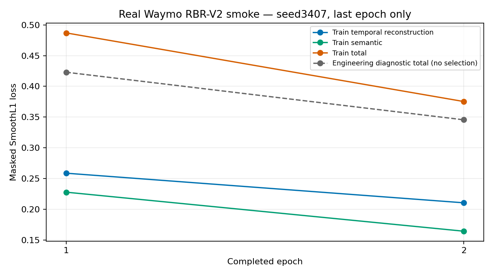

# RBR-V2-SMOKE：真实Waymo小规模训练总报告

**最终结论：`RBR_V2_SMOKE_TRAINING_PASS`。真实2048窗口、2完整epoch、32次optimizer.step、双Head共享编码器梯度、checkpoint保存、新进程重载、256×64真实表示导出均通过。**

工程状态永久为`RBR_V2_ENGINEERING_SMOKE_ONLY`；checkpoint永久标记`SMOKE_ONLY_NOT_PRIMARY_CHECKPOINT`。来源不确定性`RAW_SEGMENT_DISJOINTNESS_NOT_ESTABLISHED`保留，旧`training_certified=false`未改。本模型不能登记为Primary encoder，诊断loss不作为U_val或泛化证据。

## 实际数据和抽样

使用上一轮既有source record索引与观察依赖图，没有重新扫描51份TFRecord，也没有读取旧错误83维数组。抽样前冻结protocol、完整可复算身份排序及处理代码hash。仅取candidate train；排除任何连接到candidate test或legacy test的观察依赖组。再按组固定哈希90%/10%分为smoke train/diagnostic，在各侧按窗口身份hash排名，跳过预定物理规则无效的窗口并记录原因，不以loss或模型输出替换。

实际物化训练2048、工程诊断256，观察依赖组分别1860和231，交集0。固定排序前缀共检查2345个身份，保留41个物理输入排除记录，前缀排除率1.7484%。
其中先验真实原始质量预检排除41个、新物化不合格0个，不把预检跳过项伪称为已重新物化。没有访问正式U_test数值样本。
选中样本全部重新读取真实Waymo原始payload并验证SHA，通过既有`from_waymo → canonical83_v1`生产接口生成80×83、channel-valid、presence、邻车身份、时间与13项目标，未改Canonical83定义。
有效ego帧数范围64～80/80，均值77.878；保留180,935个邻车存在的slot-frame，不是仅用自车或全零邻车占位。

完整样本身份见`selected_samples.csv`，完整mask和时钟在每个NPZ中，数据manifest逐文件绑定SHA。2048训练窗口有效字段拟合normalizer；256诊断窗口从不参与拟合。另用独立sum/sum-of-squares算法逐字段复核训练统计和有效计数，输入与13目标均通过。缺失值、TTC/THW sentinel由mask排除。观察图分组互斥不能证明上游原始采集segment独立。

## 真实训练而非单元测试

直接复用原GRU128共享z64及Semantic13/Generic Temporal两个Head，没有架构搜索或新监督。seed3407、batch128、epoch2、AdamW lr0.001/weight_decay0.0001、clip1、两loss权重1:1均冻结。全部2048训练行每epoch固定seed打乱一次，16个完整batch；最后完整epoch2是唯一Smoke交付checkpoint，无best-epoch搜索、无early stopping。诊断仅做数值记录。

每个真实step分别以两个loss对共享GRU+projection计算autograd梯度，再对总loss执行backward、clip与一次optimizer.step。32步两种共享梯度均非零且有限，GRU/projection及两Head每步均有真实参数变化；初末参数hash不同，总参数变化L2为4.67231578。完整分组梯度、逐参数变化、NaN/Inf检查和每batch身份hash见`run/steps.json`及`run/parameter_changes.json`。

L_repr到共享encoder梯度L2范围：0.01240449～0.07754006；L_sem对应范围：0.01844399～0.09439863。这些是实际训练batch的梯度，不是沿用合成fixture的结果。

| Epoch | L_repr | L_sem | Train total | 工程诊断total | 训练秒数 |
|---|---:|---:|---:|---:|---:|
| 1 | 0.258870 | 0.228027 | 0.486897 | 0.422973 | 10.09 |
| 2 | 0.210744 | 0.164581 | 0.375325 | 0.345620 | 9.71 |

这些loss只证明工程链路能学习并数值运行，不证明行为表示科学有效、泛化、未知行为发现或优于H30。

## 设备、资源与时间

实际训练设备：**MPS**；PyTorch 2.9.1，NumPy 2.2.6，独立Python环境。原nuPlan环境不覆盖。先进行零optimizer更新的设备兼容性检查，再冻结设备；实际run只启动一次，独立父进程实施1800秒硬墙钟上限，没有通过新建账本重获预算。

真实训练进程墙钟 **23.33秒 / 1800秒**。32个step累计19.76秒、平均0.6174秒/step，实测207.31窗口/秒；每epoch训练、诊断和每step数据准备、设备阶段、CPU秒数均保存。记录的最大设备driver/进程内存指标为167,755,776字节（MPS driver分配量不是GPU利用率）。CPU进程时间和MPS实际张量设备/分配内存有实测，未采样GPU百分比，不虚构利用率。

真实数据物化墙钟1363.90秒，4个CPU worker；这是独立的数据准备阶段，不冒充训练墙钟。原始安装直连下载缓慢后改用代理，完整安装日志保留；不是第二次训练。依赖精确版本见`runtime_requirements.txt`。

## checkpoint重载与真实z64

epoch2 checkpoint：`run/epoch2_smoke.pt`，SHA256 `fa10f6ddee26b1e46c6e7652b6d697f14e5178fa97221f4fe33dcf876e009cca`。

训练normalizer SHA256 `c50ee884e2ddd99c4017991350fb5f4ebd59b44f0a525ee0c8d7a997807e8fae`。数据manifest SHA256 `d21542a9b5276a8d49ed72c77b287c81dd641ce8a326fcc6adb050dcf5b82f12`。

训练进程退出后，在新进程重新加载checkpoint和normalizer，对事前固定的全部256个真实诊断窗口以eval模式、不遮挡输入导出`export/diagnostic_z64.npy`，shape=[256,64]、全部有限。新进程与训练进程内参考的最大绝对差为0；新进程内重复eval最大差为0，均满足事前atol1e-6/rtol1e-5。z只来自共享编码器，不拼接语义真值或预测。前8行CSV只作表示输出示例，不挑选检测效果。

实际z64 SHA256 `6c811de27f0e40daf9502e895c33ef74ca030da34ee8b8633e950e6dd8efa20f`。源码和配置hash在checkpoint、execution freeze和最终Manifest间交叉绑定。

## 有条件的全量资源估算

当前未认证候选train中有132,317个自车有效窗口，batch128需1034 step/epoch。若硬件、运行时、IO、邻车密度与本次一致，并保留本次每步三次反传的梯度审计成本，则线性外推训练约10.64分钟/epoch，30epoch约5.32小时；不含未来完整U_val及额外checkpoint开销，也未假定early stopping或未实测加速。按本次4-worker数据物化吞吐，候选train重建约21.76小时。

这只是基于当前小样本吞吐的条件预算，缓存、批量装配、场景复杂度、硬件热状态都可能改变结果。正式来源认证后样本数量可能变化，必须重新计预算。**没有执行全量训练，没有授予全量模型资格，也没有由此解除科学来源阻断。**

## 验证、历史保护与边界

采样/测试源排除边界测试与源码编译、临时依赖检查通过；PASS的主要依据是实际32步更新和跨进程重载，而不是单元测试。5,689个既有文件逐字节保护校验无变化；旧training_certified仍为false。受保护CSV SHA256仍为`e8deb93312e82183b6c2c0db30fd18cbf9c32d32d566038419a5be65b389d9d8`。用户原有设计文档和Quick未提交内容保留，Quick只追加本轮命令。

本轮RBR/H30比较、BDD/MMD、Primary V/C、新nuPlan仿真、全量正式训练及3408/3409均为0。B1、C2、旧P2、F2、SDC-v1结果及账本不回写。唯一实际训练是本次工程Smoke，不能当作科学效用结果。

下一阶段应基于本次实测吞吐与数据风险，决定正式U来源/划分主张、全量物化和预算；无需重做已经打通的Canonical83/GRU双Head基础链路。本轮完成后停止。
