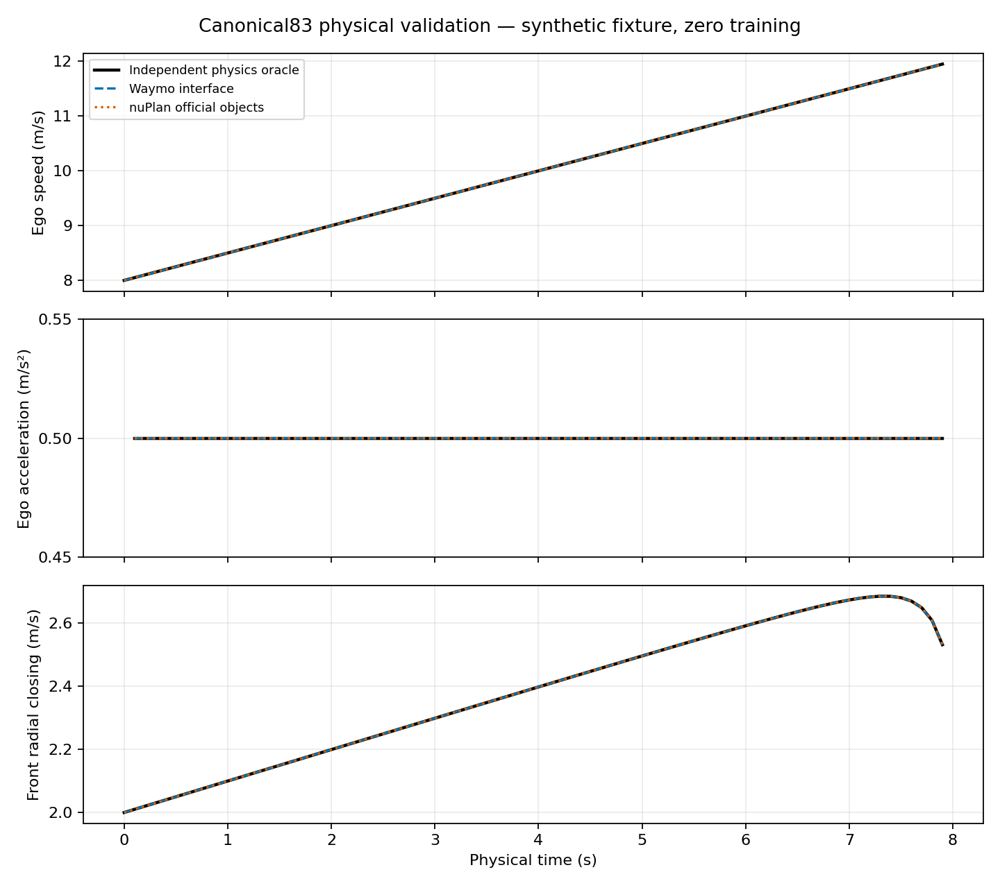

# RBR-V2 U-only 首次工程交付总报告

**结论：结果B，`BLOCKED_U_SOURCE_INDEPENDENCE`。输入修复、来源依赖审计、候选重划分、共享z64及双Head实现已完成；正式训练没有启动。没有checkpoint、最佳epoch、训练loss曲线或模型效果结论。**

基准提交：`d2bbda12aa78e1fb15353d617f72be36cf5bacee`；分支`20260825_stageR_new`。本轮条件训练授权继承S1R已批准U-only边界及S3-P0单候选，不重新选择研究方向。S3-P0历史文件不回写，旧“未授权”记录保留其历史时点含义。

## 做成了什么

1. 新建`canonical83_v1`及Waymo/nuPlan实际对象适配器，旧Stage5/6/7完全保留。83个字段逐项定义、单位、有效掩码及实测误差见[字段与物理验证CSV](Canonical83_Fields_And_Parity.csv)。不再把[5,80,15]直接reshape成[80,75]。新接口直接按[time,slot,field]写入。
2. 全部51个原始TFRecord重新读取并核对既有SHA256；扫描24,872个Scenario、1,469,220条vehicle轨迹。原始record身份、偏移、payload SHA、时间、可用字段重新索引。
3. 对全部车辆的连续8帧移动片段逐帧错位匹配，共19,425,197个片段（精确和保守量化各一份检索键）。先组依赖，再固定哈希划分；没有用下游结果筛选。
4. 新候选窗口索引保留全部168,700个旧U身份，划分变为train 134,478 / val 17,683 / test 16,539。这是**未认证候选索引**，不是已经独立有效的新训练集。依赖组内不删除重复观测、不选择好样本；重复仍可能在同组同split内存在，训练权重与独立性不能混为一谈。
5. 全部候选自车重新做物理有效性审查：166,061个满足至少64/80真实有效帧及至少2个相邻差分，2,639个不满足，排除率1.5643%。有效候选train 132,317 / val 17,430 / test 16,314。这不是完整邻车上下文生产验收，更不是来源认证。
6. 固定哈希选取16个真实原始窗口，通过新生产适配器重新计算全部83维及mask/身份；1个保留为input-invalid，没有更换它凑通过率。仅这16个真实canonical示例已物化；**没有宣称168,700窗口全部重建完成**。未在来源阻断下把候选升级成生产训练语料。
7. 单候选模型、双loss、train-only流式normalizer、冻结配置、U_val选择规则、训练拒绝入口及z64导出实现完成。两个Head分别反向传播到GRU的零优化步测试通过。正式训练和导出尚未获数据入口认证。

## 83维的物理合同与验证

80个固定10Hz时间位置，原始时间先保留float64/整数微秒，再映射0到7.9秒；不得把epoch秒转float32后差分。中心位置、完整二维速度、世界heading均有显式来源。自车位置与速度投影到首个有效自车heading坐标系；邻车相对位置与相对速度投影到当前自车heading。

closing为`-dot(p_n-p_e,v_n-v_e)/distance`，不再把自车速度减两次。同速8m/s、前方20m的样例得到closing=0、TTC无效、THW=2.5s。TTC是中心距离/径向接近速度的代理，不宣称车体碰撞预测；THW只在正纵向间距且自车正向速度成立时有效。无效TTC/THW保留999及mask=false，不能参与normalizer统计。

加速度取速度模长的后向物理差分，yaw-rate取**绝对世界heading**的包角差分；初帧、缺帧或邻车身份切换对应导数无效。没有平滑或跨缺口伪造状态。重采样只允许两个相邻有效源端点且间隔不超过0.15秒，不外推、不跨无效帧。空槽与地图/投影不可用分别通过presence和channel mask表示，禁止静默几何fallback。槽位仍调用现有生产lane-aware selector，Waymo侧邻接遵守proto分段拓扑。nuPlan使用官方Lane/Polyline接口转换整lane邻接；官方LaneConnector不能确定侧邻接时，四个侧槽的presence和全部连续字段均mask=false，不伪称没有侧车。两源拓扑粒度的差别由版本化地图适配与mask披露；新模型不把slot当永久车辆身份。

官方运动模型的EgoState速度在车体坐标使用；新nuPlan适配器获取车体中心完整速度并旋转到世界坐标，再与世界坐标交通对象速度比较。入口要求显式提供有证据的body/world声明；来源坐标未知时拒绝，绝不靠speed×heading猜测横向速度。当前证据支持官方模型对象适配，**不认证所有历史数据库包装器的坐标声明**。真实跨数据集不会具有相同驾驶轨迹；数值parity指同一规范运动经两套实际接口的对照，不是宣称真实Waymo与nuPlan样本逐值相等。

独立解析多项式oracle不调用生产旋转、差分或closing公式；Waymo typed protobuf与官方nuPlan EgoState/Agent/DetectionsTracks两入口分别核验。五个槽均有不同运动，验证80×83排列；另测侧向速度、角度环绕、缺帧、身份切换、同速跟车和大时间戳。容差abs 4e-5、rel 2e-6用于已声明的float32源heading/velocity量化，不用于修改科学测量阈值。

## 为什么不能启动训练

观察到的依赖图为22,527组，其中2,136组含多个Scenario，最大5个Scenario。精确片段产生2,335条实际合并边，量化片段再产生10条保守合并边；它们是并查集合并次数，不是全部重复对的数量。量化合并可能过于保守，不能把每条边都宣称为同一原始采集片段的确定证明。

其中754个观察依赖组跨旧split，涉及1,607个Scenario、11,049个候选窗口。这表示这些窗口处在风险依赖组，不是认定其中每个窗口均为精确重复。新候选组跨split=0；S3-P0已确认的两条精确重复ego现处于同一test组。新旧split变化57,462行，完全由冻结组哈希决定，不保留旧test来挑有利结果。

但全部24,872个原始Scenario时间起点都是0，schema及当前51份文件未提供原始采集segment、跨Scenario全局对象身份及绝对采集时间映射，camera/lidar附加帧均为0。TFRecord是容器，不能作为独立驾驶来源单位。Scenario ID互斥、文件互斥、精确/近似去重均不能补出这些缺失事实。

残余未知包括：同片段不同时间/不同车辆而没有重合片段、少于8帧或静止重叠、量化边界附近近似重叠，以及Scenario坐标原点变化使世界坐标匹配失效。没有声称穷尽模糊/平移/旋转等价的物理重叠，也没有仅凭相似的标准化匀速动作合并无关车辆。因此必须保留`RAW_SEGMENT_DISJOINTNESS_NOT_ESTABLISHED`，新候选数据`training_certified=false`。这不是可通过改mask、再跑几个测试或降低门槛解决的工程故障。

## 模型和训练合同的完成范围

固定`canonical83 + 83有效位 + t/7.9 → 单层GRU128 → 128-ReLU-64共享z → Semantic Head(64→64→13) + Temporal Head([z,t]65→128→83)`。无效ego位置不更新隐状态，不压缩物理时间。z接口[N,64]，不拼接语义真值或预测，不强制残差相减，不宣称已获得语义独立信息。

语义13目标来自U的速度、速度变化、加速度、jerk、绝对yaw-rate、总转角和中心路径长度，具体计算见`semantic13`和S3-P0定义；全部依据物理量重算，不使用旧Raw33错误导数或ego13距离监督。两个loss均通过共享z对编码器回传。通用目标是15%有效连续通道的2帧span遮挡重建，presence不作为重建目标；没有人工距离、triplet、机制标签或样本对挖掘。该监督提供已知语义约束，不构成新行为发现能力的自我证明。

固定AdamW lr0.001、weight_decay0.0001、batch128、clip1；唯一seed3407、最多30epoch、patience5、U_val总loss严格改善>1e-6、并列取早期；验证遮挡由数据hash/行身份/固定seed2026102301决定。U_test不用于训练或选择。配置继承S3-P0，取消其未经本轮授权的3408/3409，唯一run目录及24h设备预算不可通过换输出目录重置。

只有U_train可拟合输入与目标normalizer，无效通道排除；角度除π、presence不变、无效归零。由于完整来源认证失败，**本轮没有拟合正式normalizer、没有训练、没有选择checkpoint、没有输出真实U表示**。trainer/exporter是已完成的条件实现与零训练验证；尚不能称作经真实训练验收的生产模型。未来正式语料、normalizer、源映射及代码/config必须共同hash冻结后才能调用。

## 科学防火墙与保护

未读取TSB/SDC成功率、H30比较或BDD结果用于模型决策；没有访问Primary保留C。nuPlan仅用于官方源码和非科学合成对象测试。B1历史PASS、C2 FAIL、F2 Development PASS、旧P2 FAIL、SDC-v1历史结果和原账本均保留。S1R U/B/V/C、H30、Primary统计合同不改；语义模型将来仍须接受强人工基线的独立比较，loss下降不替代检测效用验证。

保护校验覆盖3,535个既有文件（用户Quick文档只追加本轮命令章节）；受保护CSV SHA256保持`e8deb93312e82183b6c2c0db30fd18cbf9c32d32d566038419a5be65b389d9d8`。原用户设计文档改动、Quick既有127行、未跟踪文件和nuplan requirements改动保留。

## 测试、资源与复现

10项单元/物理/梯度/防火墙测试通过；真实原始输入16个固定窗口全部产出（15满足输入门槛、1如实不合格），最终源码再次逐数组复现这16份产物，不覆盖原字节；完整原始身份与轨迹扫描完成。入口拒绝是预期的正确行为，不是失败后另换seed。新增源码全部通过实际训练运行时Python3.9编译；仓库全量tools通过系统Python3.13编译。全量历史tools在Python3.9编译发现旧`build_unified_bdd_posttraining_report.py:550`使用新版f-string语法，已如实保留失败日志，未改动此无关受保护脚本。临时依赖检查通过，日志随hash绑定。

全来源与重叠census实测墙钟482.59秒；全候选质量扫描90.36秒；真实16窗口物化22.89秒、最大RSS245,694,464字节（见系统资源日志）。训练设备消耗严格为**0秒/24小时**，optimizer steps=0。未计量的编辑与编译耗时不伪称为精确总CPU。大型排序索引保存在本地并由hash绑定，不提交约2.8GB可再生中间文件；完整名单、依赖边、组、质量CSV及原始记录索引进入Git。

第一次raw解析因既有环境protobuf C++接口冲突停止；以独立target安装protobuf4.25.8修复，没有修改冻结nuplan环境。全槽fixture曾错误假设会发生换道/超越的运动仍保持固定槽位，修正解析fixture后通过，生产槽位规则未改；全部开发日志保留。这些是工程尝试，不是训练attempt，也未消耗科学样本。

## 唯一推荐的后续路径

获取带来源证据的`Scenario → 原始采集segment/session → 绝对时间/对象命名空间`映射。源持有者若不能提供，应改用能证明这些信息的新U来源；这属于外部数据选择，不能由本地去重算法伪造。随后在**新数据版本**中按真实来源合并现有依赖图、先分组再划分、完整物化canonical83、只在train拟合normalizer、重做零训练绑定，才能执行已固定seed3407候选。不得只把当前manifest的false改成true。当前没有需要Owner重新选择架构或主统计规则的事项；阻断是缺少可认证的来源事实。

本轮停止在来源阻断，已交付可复用输入/模型/审计实现。没有自动启动仿真、训练、下游比较或Primary。
