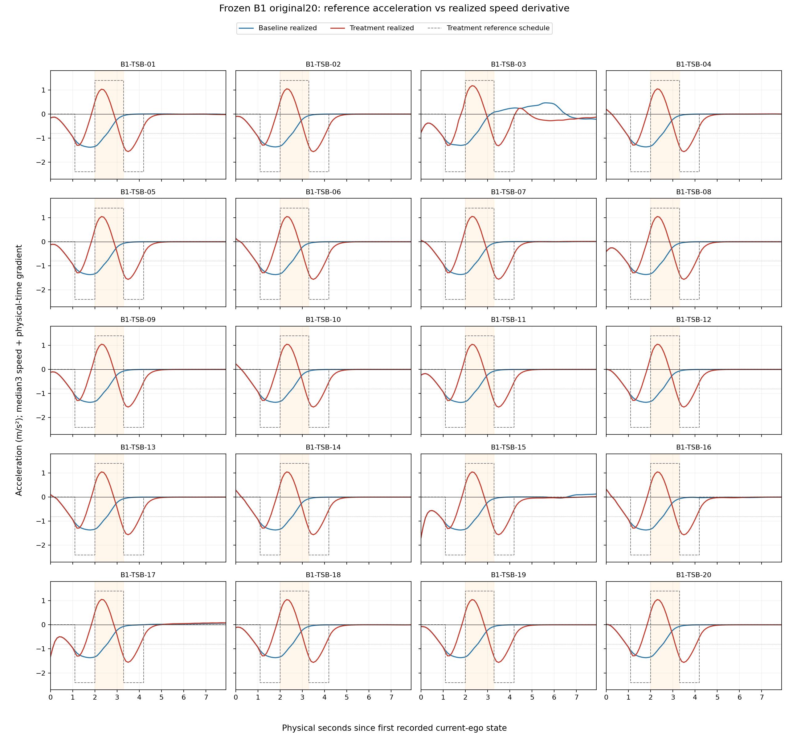

# TSB-SR Scientific Construct Validity Review v1

审查状态：`CONSTRUCT_LABEL_REQUIRES_PRECISION_ROUTE_DECISION_PENDING_OWNER`。基准HEAD为`3ae54cf9a5159d3a38fac8f9da718ee0d82b5874`。本文件是语义与适用性审查，不是新协议、B1重判或Primary结果。

## 先用大白话回答

如果“两脚制动”特指“两次刹车之间松开刹车、近似滑行”，当前TSB**不符合这个狭义描述**。它确实有两次制动，但中间主动给了正向速度恢复目标，实际闭环也明显提速；准确名称应为**制动—正向加速度恢复—再次制动**。

这不使B1的20/20资格结论失效，也不自动使博士研究无效；它影响的是**究竟验证了什么**。当前可以检验已知、受控闭环时序干预下学习表示相对强人工H的检测效用；不能把这个实验包装成自然滑行式两脚制动、人工特征难以捕捉的纯残差、一般未知行为发现或真实驾驶员意图识别。

## 1. 冻结对象及确切来源

`r2_b_tsb_round_0_parameters_v1.0.json`与B1资格协议明确规定：

| arm /阶段 | 名义episode时间 | reference acceleration | 名义时长 |
|---|---|---:|---:|
| Baseline制动 | [1.1,2.9) s | −1.45 m/s² | 1.8s |
| Treatment第一制动 | [1.1,2.0) s | −2.4 m/s² | .9s |
| Treatment中段恢复 | [2.0,3.3) s | **+1.4 m/s²** | **1.3s** |
| Treatment第二制动 | [3.3,4.2) s | −2.4 m/s² | .9s |

这些是**未来reference速度轨迹的生成参数，不是实车加速度或油门踏板测量值**。`r2_b_controller_aware_generator_v1.tsb_controller_aware_acceleration`返回该正值；`r2_b_controller_aware_planner_v1._tsb_states`按`v_next=max(.2,v+a_ref*.1)`积分，再生成route-aligned位置/航向供官方LQR/controller/motion model跟踪。planner构造的EgoState加速度字段即使为0，也不抹去速度/位置参考中的加速意图。实际正加速度证据来自已冻结current-ego speed的物理时间导数，不是把+1.4参数直接画成“实测”。

LQR约1秒预瞄、轨迹拟合、逐步重规划和运动模型响应使峰值衰减、相位边界提前或延后。介入前双方强制共享完整baseline参考，因而两条曲线可在1.1s以前共同减速；这不是本次发现新的treatment preview不一致。不能把参考阶段时间直接当闭环阶段起止。

## 2. 原始设计为什么是正向恢复——证据与推断分开

| 历史证据 | 能确认的内容 | 不能倒推的内容 |
|---|---|---|
| `tools/r1_residual_generators.py`旧TSB Mild/Nominal/Strong | release_intensity已为+.3或+.4m/s²，正恢复早于当前B1 | 不能说正加速度是为这20对结果临时添加 |
| R2-A transfer报告及replanning审计 | 小幅两脉冲在预瞄/重规划下衰减，边界迁移、lookahead mixing、release carryover影响相位形成 | 报告的“release response为正”是相对first brake peak的回升，不等于所有这些早期运行绝对a>0 |
| R2-A→R2-B architecture decision / R2-B generator contract | 采用controller-aware precompensation+DEV-only校准，分别规定第一/恢复/第二段幅值及时长 | 没有自然驾驶员“松刹/踩油门”的语义验证 |
| commit `16a931634c2cd7ca7546427728278c2575b6c6df`中的freeze代码及round0参数 | +1.4×1.3在DEV-CAL第0轮仿真前已写定；release搜索空间+.8～+2.2，未包含0；第0轮8/8开发通过后保留 | 没有可审计的计算推导证明恰好+1.4是唯一或最小必需值；不能补写成做过near-zero消融 |
| B1冻结协议与最终R2报告 | B1是在原数值下做原20对资格验证，最终20/20 PASS | 没验证coast版本，不等于自然驾驶语义construct已验证 |

因此原始记录支持“为控制器传递和冻结恢复/分相目标进行预补偿”，而非“为了模拟真实驾驶员纯滑行”。参数与门槛公开承认正恢复；在查阅材料中没有发现明确预注册的near-zero coast承诺。问题主要是`WITH_RELEASE / 两阶段制动 / 松刹`的日常联想过宽：**若将release解释为近零滑行，就是不准确的科学措辞**，需要前瞻澄清，不能重写历史参数或动机。

补充的本轮算术解释（不是历史动机证据）：名义速度变化Baseline=−1.45×1.8=−2.61m/s；Treatment=−2.4×.9+1.4×1.3−2.4×.9=−2.50m/s。正恢复抵消两次较强减速，使名义净降速接近；但这不是实现后的F_match等价证明，更不说明中段无人工可见信号。没有新增generator运行或反事实仿真。

## 3. 正加速度是不是资格成立的必要因素

冻结机制包含两个不同要求：分相间隙至少有足够样本满足a≥−.20；同时`interstage_release_fraction≥.15`。

冻结公式为`f=(max(v_gap)−v_first_end)/D`，`D=max(v_first_start−min(v_first_phase),.1)>0`。因此f≥.15要求gap相对第一制动结束速度的回升≥.15D；严格恒速或一直降速的中段不能满足。仅仅有a≈0的阶段并不足以通过现行恢复门槛。

结论分三层：**某种正速度回升**是现行恢复资格的内在要求；**当前+1.4×1.3数值**的唯一必要性没有被证明；**广义两次制动**本身并不在物理上要求中间主动提速。非常轻微、足够长的正加速度是否仍被称为near-zero，需要另行定义；不能把所有“近零”情形数学上等同严格a=0，也不能用本轮语义讨论放宽旧门槛。

## 4. 20对实际曲线的描述性方法

原始B1 roster、40个已完成arm全数保留；18 Treatment使用正式ATTEMPT_2，原不完整ATTEMPT_1永久保留但不能代替完整80帧。所有40条trace逐一匹配原冻结SHA。没有重新运行B1 qualifier、F_match、安全或PASS/FAIL逻辑。

- 01–17没有现存持久化逐帧measurement JSON，本轮只对冻结80帧current-ego轨迹按既有`median3(speed)`（edge-replicated）及`np.gradient(smoothed_speed,physical_time,edge_order=2)`公式做描述性导数。18–20直接读取冻结measurement acceleration数组，并核对所对应的trace/speed；其原六位小数舍入保留。
- 所有时间为首个current-ego timestamp起算的秒。第一/第二制动峰以固定名义command bracket [1.1,2.0)、[3.3,4.2)定位；Baseline用[1.1,2.9)。不做择优窗口搜索。
- 制动“持续时间”是包含该锚定峰的连续a≤−.8支持区间，用相邻实测加速度点线性插值阈值交点；这只描述duration，不重算phase_count、不应用合并或资格判据。CSV同时提供sample start/end/span，避免把N个采样点机械解释成N×.1秒。初始瞬态的更大负峰另列preintervention字段，不能冒充第一脚制动。
- 正恢复段为两制动支持区间之间、包含最大a的连续a>0区间，线性插值零交点。速度恢复为同区间端点的median3速度差；另列raw-speed差作佐证，以及gap最低至最高恢复、冻结release-reference numerator，三者不混用。所有新增指标均为描述性，不是新科学门槛。
- 20对是固定研究样本；min/median/max不等于自然驾驶总体分布、可靠性置信区间或新功效结论。阈值交点是采样曲线近似，不能把CSV小数位当微秒级物理准确性。

## 5. 20对总体特点

下列制动峰以减速度**幅值**表示，实际符号为负；时长均采用上述描述性threshold/zero-crossing定义。

| 描述量 | 中位数 | 20对最小～最大 |
|---|---:|---:|
| Treatment第一制动峰幅值 | 1.2905 m/s² | 1.2861～1.3040 |
| 第一制动时长（a≤−.8） | .6679s | .6602～.7144 |
| **中段正加速度峰** | **1.0465 m/s²** | **1.0322～1.1780** |
| **连续正加速度时长（a>0）** | **1.0122s** | **1.0087～1.1357** |
| **正加速度段速度恢复** | **.6762 m/s** | **.6656～.8425** |
| 同段raw速度恢复（佐证） | .6790 m/s | .6675～.8588 |
| Treatment第二制动峰幅值 | 1.5626 m/s² | 1.3169～1.5662 |
| 第二制动时长（a≤−.8） | .9500s | .6838～.9576 |
| Baseline制动峰幅值 | 1.3655 m/s² | 1.3016～1.3785 |
| Baseline制动时长（a≤−.8） | 1.6555s | 1.6237～1.7016 |

20/20均有上述正加速度恢复段，此为新描述性读数而不是重判B1。恢复期间Baseline仍降速，中位约−1.0012m/s（范围−1.0065～−.9995）。Treatment的峰大致在1.2s/2.3s/3.5s；正加速度起止中位约1.843～2.855s，已经与名义[2.0,3.3)恢复阶段明显不同。

大多数形态相近，符合固定全局干预的传递；初速仍跨4.019～14.386m/s。B1-03的正峰1.1780、恢复.8425m/s、第二峰1.3169/时长.6838s较不同；其后段也有与多数成员不同的响应，全部保留。B1-15/17第一制动支持稍长，部分初始瞬态也较强。没有据此做异常剔除或把差异归因到某个未检验的速度/道路因果因素。

全部个体数值、来源及时间边界见`TSB_SR_20Pair_Acceleration_Characteristics_v1.csv`；全20对图如下。图中虚线是reference schedule，不是LQR实际命令、踏板状态或实测加速度。

### 原20对逐对概览

减速度列为幅值；时长为插值阈值交点时长；全部数值仅描述冻结曲线，原PASS状态未重算。

| pair | v0 m/s | 第一制动 m/s² | 正峰 m/s² | 正段 s | 恢复 m/s | 第二制动 m/s² | 第二制动 s |
|---|---:|---:|---:|---:|---:|---:|---:|
| B1-TSB-01 | 12.455 | 1.300 | 1.032 | 1.009 | 0.666 | 1.558 | 0.946 |
| B1-TSB-02 | 8.500 | 1.290 | 1.048 | 1.013 | 0.677 | 1.563 | 0.950 |
| B1-TSB-03 | 4.695 | 1.301 | 1.178 | 1.136 | 0.842 | 1.317 | 0.684 |
| B1-TSB-04 | 12.429 | 1.288 | 1.046 | 1.012 | 0.676 | 1.563 | 0.950 |
| B1-TSB-05 | 11.901 | 1.291 | 1.046 | 1.012 | 0.676 | 1.563 | 0.950 |
| B1-TSB-06 | 14.386 | 1.289 | 1.047 | 1.012 | 0.676 | 1.563 | 0.950 |
| B1-TSB-07 | 11.675 | 1.286 | 1.053 | 1.016 | 0.682 | 1.556 | 0.944 |
| B1-TSB-08 | 12.561 | 1.292 | 1.047 | 1.013 | 0.677 | 1.563 | 0.950 |
| B1-TSB-09 | 10.760 | 1.291 | 1.047 | 1.012 | 0.676 | 1.562 | 0.950 |
| B1-TSB-10 | 13.794 | 1.288 | 1.047 | 1.012 | 0.676 | 1.563 | 0.950 |
| B1-TSB-11 | 13.122 | 1.292 | 1.042 | 1.009 | 0.671 | 1.563 | 0.951 |
| B1-TSB-12 | 13.616 | 1.287 | 1.047 | 1.012 | 0.676 | 1.563 | 0.951 |
| B1-TSB-13 | 14.152 | 1.289 | 1.047 | 1.012 | 0.676 | 1.562 | 0.950 |
| B1-TSB-14 | 10.557 | 1.287 | 1.046 | 1.012 | 0.676 | 1.563 | 0.950 |
| B1-TSB-15 | 4.769 | 1.304 | 1.046 | 1.012 | 0.676 | 1.563 | 0.948 |
| B1-TSB-16 | 8.215 | 1.288 | 1.046 | 1.013 | 0.676 | 1.566 | 0.958 |
| B1-TSB-17 | 4.019 | 1.301 | 1.055 | 1.016 | 0.685 | 1.557 | 0.941 |
| B1-TSB-18 | 12.415 | 1.291 | 1.046 | 1.012 | 0.676 | 1.563 | 0.951 |
| B1-TSB-19 | 10.981 | 1.291 | 1.046 | 1.012 | 0.676 | 1.563 | 0.950 |
| B1-TSB-20 | 12.723 | 1.290 | 1.046 | 1.012 | 0.676 | 1.563 | 0.950 |

## 6. construct validity结论

**实现有效性**：B1证明原定义干预在冻结平台/适用域达到原资格要求；保持`B1_TSB_BENCHMARK_QUALIFICATION_PASS`。

**行为语义有效性**：名称必须明确有主动正向恢复；没有自然驾驶员标注/真实双脚动作证据，不能声称真实驾驶员犹豫、风险认知或纯松刹滑行已验证。严格coast是另一个construct。

**区分/比较有效性**：F_match只限制四个全窗描述符的caliper，不保证ego13或H不可见，更不保证因果上只剩“时间顺序”一个因素。本轮不做新H/RBR/BDD/MMD计算。当前基准可用于已批准、范围有限的强H对照检测问题；不足以支持未知家族发现或人工信息独立性。

**外部适用性**：20个SESSION仍来自固定nuPlan/nonreactive controlled setting；不是自然驾驶员总体、真实E2E软件版本或生产发布效益验证。

## 7. v2.4仅建议修订的措辞

本地`RBR-64 博士研究总体方案 v2.4.md`仍是未入库整合草案，部分B1快照过时；本轮读取/hash保护，**未修改原文**。

1. §4.4、§7及全篇TSB首次出现处：增加“制动—正向加速度恢复—再次制动；release是速度恢复，不是预注册近零滑行”。
2. §3/§9 Level2：明确对这一已知受控干预比较固定FPR检测效用，不预设RBR胜H，不预设人工难以刻画或单一时间次序因果机制。
3. §7.3/§14 residual表述：F_match合格仍可能有低阶与generic temporal人工信号；保留两个NOT_ESTABLISHED。
4. §5/§12的B1状态建议另行同步正式20/20 PASS及本次construct review；不得把措辞修订当新的科学授权或覆盖旧报告。
5. 若Owner另选coast问题，另立版本/协议/授权，不能把原+1.4的B1改称coast验证或把路线B自动列为已批准Primary。

## 8. 保护与验证

`LOW_ORDER_NUISANCE_ELIMINATED=NOT_ESTABLISHED`；`TSB_CLEAN_RESIDUAL_TASK=NOT_ESTABLISHED`。本轮SIMULATION/RBR_TRAINING/H_BDD/RBR_BDD/MMD/PRIMARY_EVALUATION/V_EXECUTION/C_EXECUTION/MODEL_SELECTION全部0，H特征向量也未计算。20/20 PASS、40完整arms、41累计attempts/1技术retry/0科学失败原样继承。

新增一个描述性工具及一个测试文件。已运行真实40 trace描述性分析和全20图、5项fixture回归、Python编译、临时依赖检查及diff检查；没有将“测试通过”当新B1科学判定。2,217个保护文件前后hash验证，含S1/S1R/B1/S3-P0和原CSV；所有输入、图表/CSV/报告hash绑定Manifest。完成后停止，路线决定见Decision Memo。
